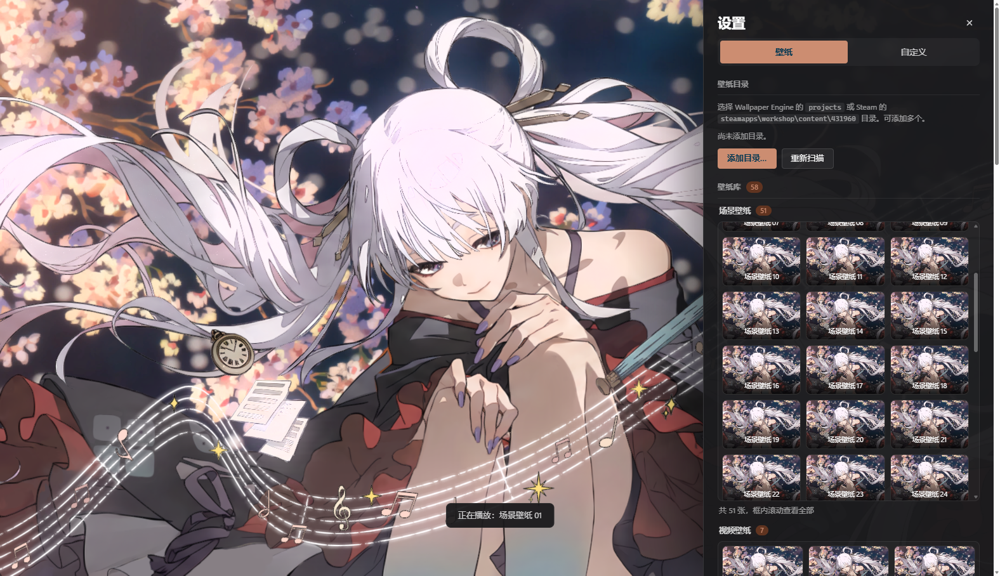

# Wallpaper Engine New Tab WE壁纸标签页

<p align="center"></p>

**观前须知:**

本项目完全为Vibe Coding，全程使用AI，遇到问题直接自己拿AI改就行了，本质是我自用的小破玩意

**本扩展刚需:**

- webwallgl https://github.com/oneincase/webwallgl
- media-bridge https://github.com/oneincase/media-bridge

**作者主页**

- B站 【在下练习两年半的坤的个人空间-哔哩哔哩】 https://b23.tv/1AaM2Iq
- github https://github.com/oneincase

可以的话给作者点个关注点个星标

## 它能做什么

- **场景壁纸**：直接读 `scene.pkg` 或散装 `scene.json`，本地渲染，不联网
- **视频 / 图片**：`video/*`、`image/*`、`gif` 走原生标签播放
- **壁纸自己的属性**：作品里做的那些滑块、开关、下拉、颜色，都会出现在面板里，拖一下立刻生效

### 设置面板

<p align="center"></p>

---

## 装上试试

安装前需要先安装上webwallgl和media-bridge

具体安装方法自行前往作者主页查看

1. `edge://extensions`（或 `chrome://extensions`）→ 打开「开发人员模式」
2. 「加载解压缩的扩展」→ 选这个仓库里的 `we-newtab` 目录
3. 新标签页右下角齿轮 →「添加目录…」→ 选壁纸目录

Steam 创意工坊的壁纸通常在：

```
<你的 Steam 库>\steamapps\workshop\content\431960\<创意工坊 id>\
```

也可以直接选 Wallpaper Engine 的 `projects` 目录，两种结构都认。

---

## 在 Steam 里找新壁纸

设置 → 壁纸目录 →「在 Steam 中浏览工坊」会在新标签页打开 Wallpaper Engine 的创意工坊页面。
点订阅后下载交给 Steam 客户端，下完扩展会自动扫到（目录监听），不用回设置里刷新。

---

## 场景渲染协议

宿主页和沙箱渲染页之间只有 `postMessage`，一条场景的生命周期长这样：

```text
宿主                                              沙箱渲染页
 │  {t:"ping"} ──────────────────────────────▶  探活（沙箱页可能比宿主先就绪）
 │  ◀──────────────────────────────────────── {t:"pong"}
 │  {t:"mount", pkgFile|entry,
 │   project, props, opts} ──────────────────▶  createScene() + load()
 │                                                └─ {t:"read", id, path}
 │  ◀──────────────────────────────────────── {t:"read:res", file}   宿主用 FS Access 读盘回传
 │  ◀──────────────────────────────────────── {t:"ready", width, height, layers}
 │  {t:"props"} / {t:"update"} / {t:"volume"} / {t:"audio"}
 │  ◀──────────────────────────────────────── {t:"stats"} / {t:"diag"} / {t:"error"}
```

| mount 字段 | 说明 |
|---|---|
| `pkgFile` | 场景包 `File`，只传引用 |
| `entry` | 散装工程入口（如 `scene.json`），和 `pkgFile` 二选一 |
| `props` | 用户属性初值，装配后会再下发一次（有些壁纸装配期不读属性） |
| `opts` | `fps` / `dpr` / `fit` / `scripts` / `quality` / `volume` |

---

## 有多快

真机：Edge 稳定版 + RTX 5070 Ti Laptop。

| 场景包 | 到首帧 |
|---|---|
| 0.17MB | ~505ms |
| 2.4MB | ~290ms |
| 314MB | ~1.6s（解析占 1.1s） |
| 视频 10.8MB | ~81ms |

时间基本都花在解析、贴图上传和着色器编译上。想压到 250ms 以内，只有很小的场景能做到——
试过关后处理、预热 WebGL、保留解析缓存，收益要么没有要么不明显，所以别信"秒开 3A 场景"这种话。

---

## 系统音频（可选）

浏览器读不到系统声音，这条只能借本地中间件：

```powershell
media-bridge-win32-x64.exe serve --http 127.0.0.1:8765
```

然后设置 → 动态效果 → 音频响应 →「系统音频（media-bridge）」，端口保持 8765。
扩展订阅它的 SSE 频谱流（`/v1/events?events=spectrum&spectrumMs=100`），64 段直接喂给场景。

没装也没关系，默认用引擎自带的模拟频谱，只是不跟真实声音联动。

---

## 显卡偏好（可选）

浏览器没有切换 GPU 的接口，得装一次本地辅助程序：

```powershell
cd we-newtab\native
powershell -ExecutionPolicy Bypass -File .\install.ps1
```

它会写 `HKCU\Software\Microsoft\DirectX\UserGpuPreferences`，卸载跑 `uninstall.ps1`。

---

## 代码结构

```text
we-newtab/
  manifest.json     MV3 清单
  newtab.html/.css  页面 + 设置面板
  core.js           基础层：DOM、IndexedDB、设置、文件系统访问
  library.js        壁纸库：目录检测、扫描、列表渲染、变更监听
  playback.js       播放层：场景/视频/图片、属性下发、效果、轮换、音频
  panel.js          设置面板：选项卡、控件、显卡、空状态
  app.js            启动流程
  props.js          壁纸属性引擎
  render.html/.js   沙箱渲染页（WebWallGL 宿主）
  vendor/           WebWallGL 运行时
  native/           显卡偏好 Native Messaging 宿主
  test/smoke.mjs    属性引擎离线用例（23 项）
  docs/             展示页与截图
```

---

## 做不到的

- 创意工坊的订阅和下载得在 Steam 客户端里做，浏览器端做不了

---

## 许可

代码 MIT。场景渲染依赖 WebWallGL（MIT，作者 oneincase），`vendor/` 里的文件原样分发。
